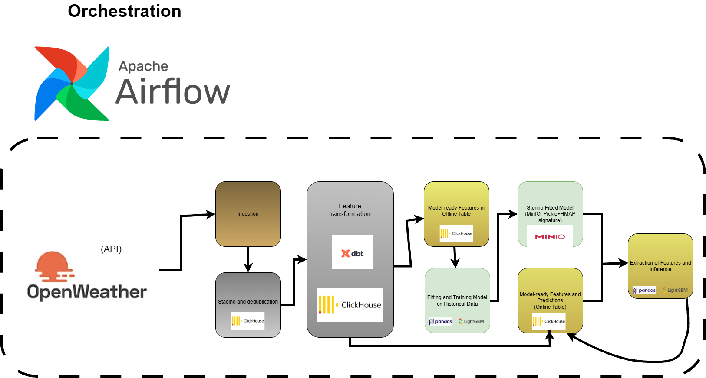
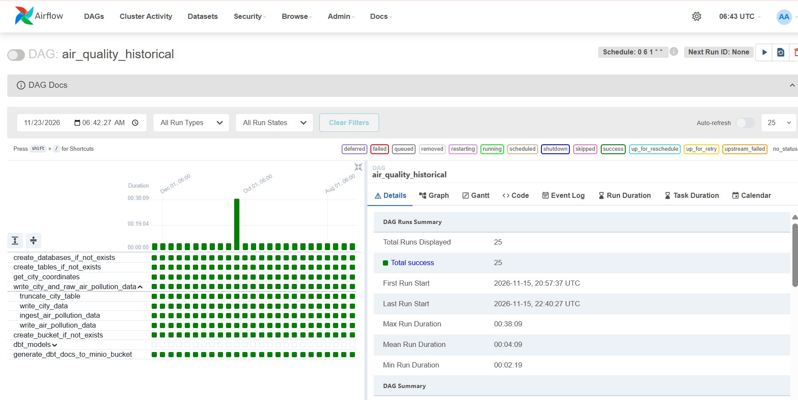

# air-quality-feature-store

## Overview of the project and the problem it solves

Machine learning pipelines introduce a constraint that traditional BI and reporting pipelines do not have: a feature is only valid if it reflects information that would have actually been available at the time a prediction is made. Violating this constraint — commonly called **data leakage** or **training/serving skew** — is one of the most common and difficult-to-detect failure modes in production ML systems. A model trained on a feature that quietly encodes the future will score beautifully in evaluation and then quietly underperform in production.

This project builds a pipeline that ingests hourly air quality data for multiple cities, engineers time-aware features from it, and produces two consistent outputs: an **offline table** used for model training and an **online table** used for live inference. A gradient-boosted tree model is trained on top of this pipeline to forecast air quality (AQI) several hours ahead. The emphasis of the project is the data engineering required to support the model, not the model itself.

The core engineering problems this project addresses:

- Ingesting and storing a growing time-series dataset reliably and repeatably
- Engineering features (lags, rolling windows, seasonality) without leaking future information into the past
- Keeping training data and live serving data consistent, so a model performs the same way in production as it did in evaluation
- Validating data quality automatically, on a schedule, without manual intervention

The value delivered:

- A repeatable hourly pipeline from raw API ingestion to served predictions
- A documented, tested feature layer shared by training and serving
- Automated data quality checks
- ML model stats table for monitoring model performance and feature drift
- A worked leakage exercise showing the inflated metrics of a leaky implementation versus the corrected one


### Directory structure

```
├── .env_example
├── .gitignore
├── compose.yaml
├── Dockerfile
├── README.md
├── requirements.txt
├── config/
├── dags/
│   ├── air_quality_helpers.py
│   ├── air_quality_historical.py
│   ├── air_quality_live.py
│   └── air_quality_train.py
├── include/
│   ├── csv/
│   │   └── latitudes_and_longitudes.csv
│   ├── dbt/
│   │   └── air_quality_feature_engineering/
│   │       ├── dbt_project.yml
│   │       ├── packages.yml
│   │       ├── analyses/
│   │       ├── macros/
│   │       ├── models/
│   │       │   └── weather_features/
│   │       │       ├── feature_air_pollution.sql
│   │       │       ├── feature_air_pollution_pit_correctness_test.sql
│   │       │       ├── stg_weather_raw__air_pollution.sql
│   │       │       ├── stg_weather_raw__city_coordinates.sql
│   │       │       ├── _src_weather_raw.yml
│   │       │       └── _weather_features_models.yml
│   │       ├── seeds/
│   │       ├── snapshots/
│   │       │   ├── city_coordinates.sql
│   │       │   └── _snapshots.yml
│   │       └── tests/
│   ├── notebooks/
│   │   └── point_in_time_correctness_test.ipynb
│   └── sql/
│       ├── create_database.sql
│       ├── create_raw_data_table.sql
│       ├── create_training_model_table.sql
│       ├── get_deduplicated_city_coordinates.sql
│       ├── update_target_aqi_live.sql
│       └── write_air_pollution_data.sql
```

### Relevance

Air quality forecasting supports genuine use cases such as public health advisories and event planning, but the value of this project lies primarily in the pattern it exercises: raw ingestion, time-aware feature engineering, offline/online consistency, and served predictions. This pattern is directly transferable to feature pipelines built for credit risk, fraud, or other predictive models in a financial services setting, where the same consistency requirements apply.

### Dataset

**Source:** OpenWeatherMap Air Pollution API (free tier), historical and current endpoints, providing hourly AQI and pollutant component data (CO, NO2, O3, SO2, PM2.5, PM10, NH3) per city.

**Coverage:** 5 to 10 cities, across parts of Africa and the Carribean

## Pipeline Architecture



The pipeline flows as follows:

1. **Extract** — Airflow fetches hourly air pollution data per city from the OpenWeatherMap API.
2. **Stage** — Parsed rows are written to a staging table in MinIO/ClickHouse staging.
3. **Load raw** — Rows are bulk-inserted into the append-only raw ClickHouse table.
4. **Transform** — dbt models compute the shared feature logic, materialising the offline feature table and the latest-row online table from the same code.
5. **Validate** — dbt tests

## Setup Instructions

Clone this repo onto your device by running this command in your terminal:

```bash
git clone https://github.com/SasheO/air-quality-data-engineering-for-predictions.git
```

Copy `.env_example` into a file named `.env` and fill in your environment variables. 

- Set `MINIO_ROOT_USER` to `admin` and pick your preferred MinIO password.
- Set `CLICKHOUSE_USER` to `default` and pick your preferred ClickHouse password.
- Put your OpenWeatherMap API key in `OPENWEATHER_API_SECRET_KEY`.

To configure user permissions:

- If you're using **Linux**, set a user ID to prevent permission issues when Docker writes files locally. Run this in your terminal and copy the value into `AIRFLOW_UID` in your `.env` file:

```bash
echo -e "AIRFLOW_UID=$(id -u)"
```

- If you're using **macOS or Windows**, leave the value in your `.env` file as is: `AIRFLOW_UID=50000`

### Set Up Connections and Variables in Airflow

In your terminal, navigate to the folder where this repository is stored and run `docker compose up`.

Open the Airflow webserver in a browser at http://localhost:9080/.

Go to **admin > connections** and click the **+** sign to create a new connection. The connections to add are:

**ClickHouse:**

- name: `clickhouse_conn`
- connection type: clickhouse
- host name: `clickhouse`
- login and password: use your credentials in `.env`
- port: `8123`

**MinIO:**

- name: `minio_conn`
- connection type: AWS connection type
- login and password: use your credentials in `.env`
- extras: paste the following and replace `MINIO_ROOT_USER` and `MINIO_PASSWORD` with what is in your `.env` file:

```json
{
    "aws_access_key_id": MINIO_ROOT_USER,
    "aws_secret_access_key": MINIO_PASSWORD,
    "endpoint_url": "http://minio:9000",
    "region_name": "us-east-1"
}
```

If you test the MinIO connection, it may fail. This is completely normal because Airflow's test engine tries to reach the live AWS Security Token Service (STS) endpoint to validate credentials, which local MinIO services do not support. Save the connection anyway. It will still work perfectly in your DAGs.

**Variables:**

Go to **admin > Variables** and click the **+** sign to create a new variable. The variables to add are:

- `OPENWEATHER_API_SECRET_KEY` — your OpenWeatherMap API key

## Steps to Run the DAG and Inspect Results by Querying ClickHouse Tables

The historical data pipeline, `air_quality_historical`, fetches data month by month up until November 2026 as this was when this project was built. Update the 'end_date' of the DAG in `dags\air_quality_historical.py` by setting the most recent month you wish to get data up to.

From the Airflow webserver, type locate `air_quality_historical` DAG and Toggle the button at the top-left of the screen to unpause the DAG. Allow it to populate all historical data as this will be used for model training. The DAG will run and populate the raw table, the offline feature table, and the city tables.



To train the model, toggle on the `air_quality_historical` DAG. Details on the model, its accuracy, and more are available in the `monitoring.ml_model_stats` table and will also show in the logs of the Dag Run.

To turn on the live hourly predictions and update pipeline, fill in 'MODEL_KEY' in `dags\air_quality_live.py` with your trained model path. An example is provided in the table

To query ClickHouse tables, open the ClickHouse Web UI at http://localhost:8143/. Enter your default username and password in the credentials dialog at the top left. Run your queries in the query box. Some sample queries:

```sql
-- Sample query: "What is the most recent AQI for each city?"
SELECT
    city,
    country,
    local_time_of_measurement,
    current_aqi
FROM weather_features.online_air_pollution_predictions
ORDER BY city, local_time_of_measurement DESC;

```

The DAG will also generate dbt docs with descriptions of tables, columns, relationships, dependencies, and data tests, viewable within the Airflow webserver via **browse > dbt Docs**.

## Data Model

### Raw layer

- One row per city per hour, fields as returned by the API, with no transformation applied
- Append-only, and serves as the source of truth for reprocessing and debugging

### Feature layer

- **Lag features:** AQI and key pollutants at 1h, 3h, 24h, and 168h
- **Rolling statistics:** 6h, 24h, and 72h trailing mean, standard deviation, and max
- **Rate of change:** 1h and 3h delta in AQI
- **Calendar features:** hour of day, day of week, weekend flag
- **Target:** AQI 6 hours ahead, computed only where the future value exists

### Offline vs. online tables

- **Offline:** full history, all features, target column included, used for training
- **Online:** latest rows per city, same feature columns, no target, used for serving and prediction

Both tables are built from the same feature-computation logic, filtered differently, so that training and serving remain consistent.

### Reasons for Various Design Choices

The raw table is append-only and untransformed so that every downstream feature can be recomputed from scratch if a bug in the feature logic is found. The feature tables are materialised from dbt models rather than recomputed in the DAG, so that the offline and online tables share a single source of truth for the feature logic — the online table is just the offline feature model filtered to the latest row per city and stripped of the target column.

## Leakage Exercise

A key deliverable of this project is a documented leakage exercise. The feature engineering was initially implemented with **centered windows** — for example, a rolling mean computed over `[t-3h, t+3h]` — which silently included future data in each feature row. The result was an apparently strong evaluation metric that could not be reproduced in production, where only past data is available at inference time.

The corrected implementation uses **trailing windows** only — a rolling mean over `[t-N, t]` — so each feature row uses only information that would have been available at time `t`.

A before/after comparison of evaluation metrics for both implementations is included in the [point_in_time_correctness_test notebook](include/notebooks/point_in_time_correctness_test.ipynb) and summarised here:

| Metric | Centered-window (leaky) | Trailing-window (corrected) |
|---|---|---|
| Accuracy | 82.0% | 78.3% |
| Final train error | 0.255 | 0.512 |

## Tests and Validation

Appropriate unique, not-null, accepted-values, and relationships tests are implemented in the dbt models. Full documentation can be viewed in dbt docs in the Airflow webserver via **browse > dbt Docs**.

To test that the pipeline fails gracefully on a bad or missing API response, a negative test case was implemented: the API key was temporarily replaced with an invalid value, which caused the extraction task to fail with a clear error and the pipeline to halt before writing any partial rows. A screenshot of the failed validation task is included in `images/`.

TODO: include screenshot

## Known Limitations and Ideas for Extending the Project

TODO: 